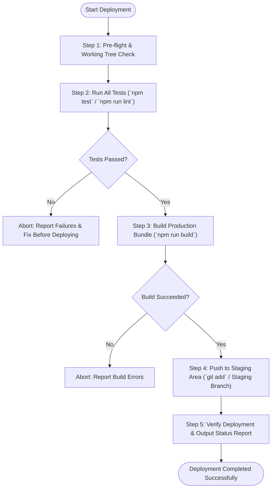

# Deploy Skill

This skill provides a standardized, automated procedure to safely validate, build, and deploy the application to the staging area. It enforces a strict "tests first" policy so that broken builds or failing tests never reach staging.

## Pipeline Workflow Overview



---

## Step-by-Step Instructions

### Step 1: Pre-flight Verification
1. Inspect the Git status and active branch:
   ```powershell
   git status
   ```
2. Check whether dependencies are properly installed:
   ```powershell
   npm ls --depth=0
   ```
   If dependencies are missing, run `npm install` before proceeding.

### Step 2: Run All Tests First (Mandatory Gate)
> [!IMPORTANT]
> Never skip tests during deployment. If any test or linting check fails, deployment MUST halt immediately.

1. **Unit & Integration Tests**:
   Execute the test suite:
   ```powershell
   npm test
   ```
   *(Or `npm run test:run` / `npx vitest run` depending on project configuration).*

2. **Linting & Code Quality**:
   Verify code style and static analysis:
   ```powershell
   npm run lint
   ```

3. **Check Test Results**:
   - If tests or linting exit with a non-zero code, **STOP immediately**.
   - Output the failure summary to the user and do not proceed to building or staging.

### Step 3: Build the Production Bundle
1. Run the production build command:
   ```powershell
   npm run build
   ```
2. **Verify the Build Output**:
   - Check that the build completes with exit code 0.
   - Verify the production assets exist in the output directory (e.g. `dist/`):
     - `dist/index.html`
     - Bundled JS & CSS files in `dist/assets/`
   - If the build fails or bundles are missing, abort and report the compiler/bundler error.

### Step 4: Push to Staging Area
Depending on your project's staging strategy, execute the appropriate staging method:

#### Option A: Git Staging Area (Local Staging for Commit & Review)
1. Add updated files to the Git staging index:
   ```powershell
   git add .
   ```
2. Verify staged changes:
   ```powershell
   git status --short
   ```
3. If a deployment commit is requested:
   ```powershell
   git commit -m "build: prepare production release for staging"
   ```

#### Option B: Remote Staging Branch or Environment
1. Fetch latest remote branches:
   ```powershell
   git fetch origin
   ```
2. Switch to or create the staging branch:
   ```powershell
   git checkout -B staging
   ```
3. Merge or cherry-pick verified changes from the current branch.
4. Push to remote staging:
   ```powershell
   git push origin staging
   ```
5. If using a staging deployment provider (e.g., Firebase, Vercel, Netlify, Cloudflare Pages, S3/GCS):
   - Deploy `dist/` using the provider's staging CLI flag (e.g. `vercel --target=staging` or `firebase deploy --only hosting:staging`).

### Step 5: Verification & Deployment Report
Provide a concise summary containing:
- **Test Status**: Number of tests run and passed.
- **Build Status**: Production bundle generated in `dist/` with asset sizes.
- **Staging Area Status**: Files staged in Git or commit hash pushed to `staging` branch/environment.

---

## Automation Scripts

To execute the entire pipeline with a single command, use the bundled helper scripts:

- **Windows (PowerShell)**:
  ```powershell
  .\.agents\skills\deploy\scripts\deploy.ps1
  ```
- **macOS / Linux (Bash)**:
  ```bash
  ./.agents/skills/deploy/scripts/deploy.sh
  ```

See [staging-workflow.md](./references/staging-workflow.md) for in-depth staging strategies, environment rollbacks, and branch management.
